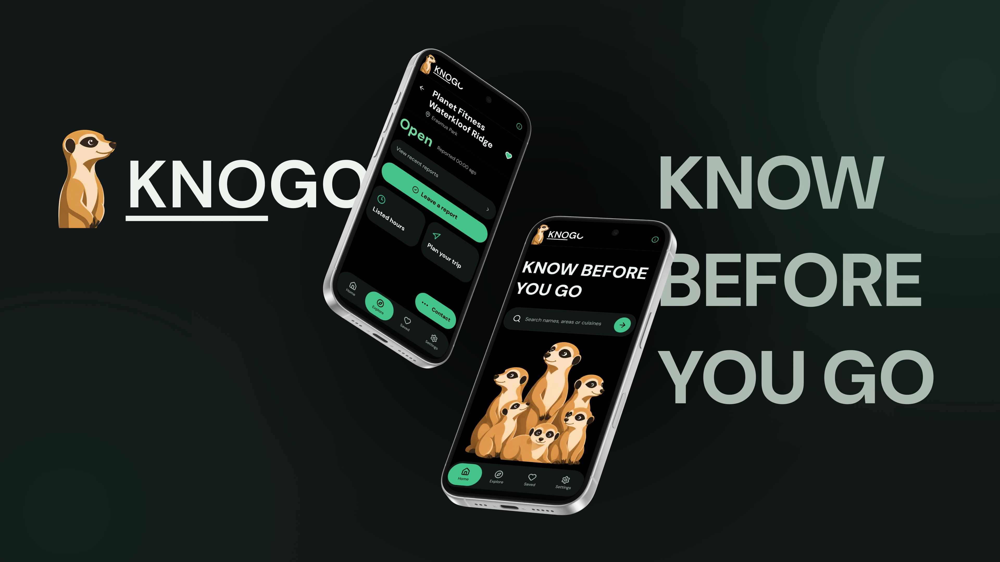
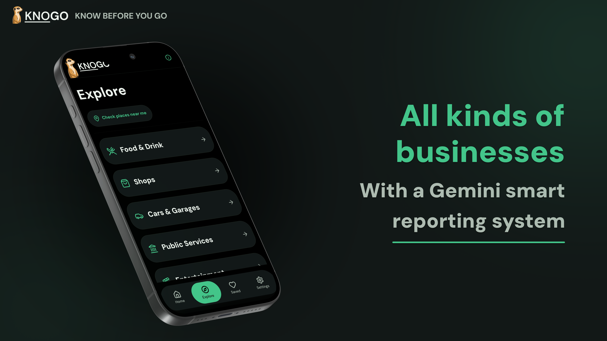
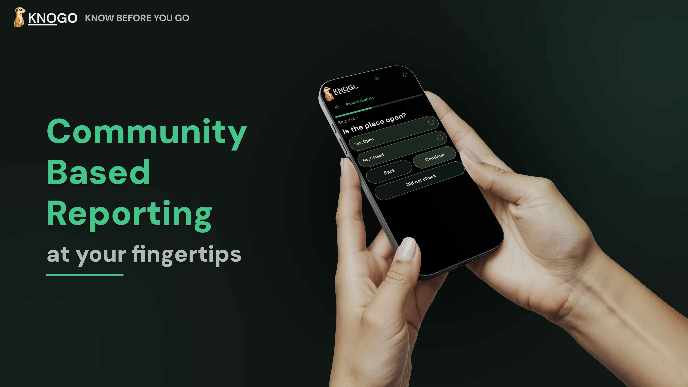
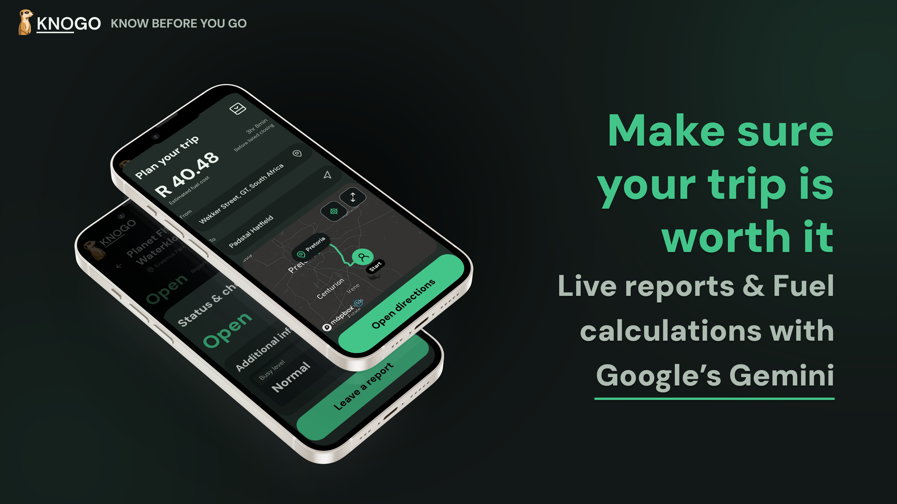
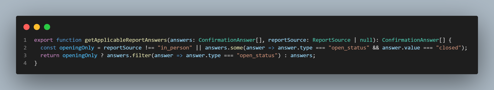
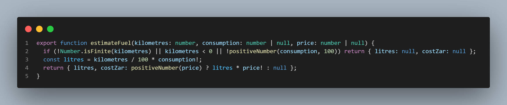
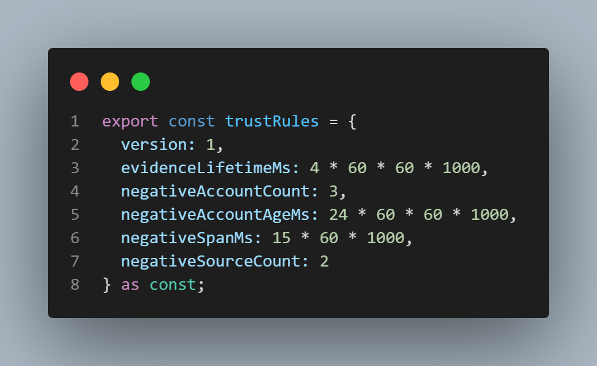

# KNOGO

Know before you go.



KNOGO is a mobile app that helps people check whether a place is open, serving and functioning before
making the trip. Opening hours can say a business is open while its doors are
closed, its kitchen has stopped serving or a disruption has affected its service.
KNOGO brings community observations, their sources and trip fuel estimates into
the decision to leave home.

The directory covers Food & Drink, Shops, Cars & Garages, Public Services,
Entertainment, and Sport & Outdoors. The catalogue is centred on Pretoria East.
Listed hours are expectations; community checks are observations, not guarantees.

Created by Xander Poalses at Open Window for DV300 and UX300.

[Features](#features) | [Reporting](#how-reporting-works) | [Trip planning](#trip-planning) | [Code](#inside-the-code) | [Setup](#get-started) | [Documentation](#documentation)


## Features



| Feature | What it provides |
| --- | --- |
| Discovery | Search by place, area or category, then filter results |
| Branches | Browse venue groups and choose the branch you intend to visit |
| Status & checks | Distinguish listed hours from opening and service reports |
| Community reporting | Submit a check made in person, by phone or online |
| Saved places | Keep places for another visit |
| Trip planning | Estimate fuel use and cost from a route and vehicle preferences |
| Account & appearance | Manage access and choose system, light or dark appearance |

Accounts, reports, routing and AI need backend and provider configuration.

## How reporting works



KNOGO treats reports as evidence. The trust rules consider report age,
agreement, account history and assessment results. Opposing evidence remains
visible, and venue disputes do not delete community reports.

Google Gemini assesses reporting patterns for signs of coordination or abuse.
It does not determine whether a venue is open or whether a person is telling the
truth. Application rules control the outcome. An unavailable or inconclusive
assessment cannot establish a community closure.

The trust implementation requires its backend migrations and worker setup.
See [community rules](docs/COMMUNITY_RULES.md) for thresholds and deployment caveats.

The survey follows what the contributor can check:

1. Choose in person, phone or online. Online checks need a source URL.
2. Answer whether the place is open.
3. A Closed answer goes to review. Phone and online checks also go to review
   without asking service questions.
4. In-person Open checks can include kitchen, busy-level and other service checks.
5. Review the answers and submit. A received report is not a guarantee of a status change.

## Trip planning



Plan a route, compare arrival with listed hours and estimate fuel use from your
vehicle's consumption. Set a fuel grade and region, or use a price override.
Missing inputs stay unset rather than becoming a guessed cost.

Fuel estimates use route data and calculations in the app, **not Gemini**.
Gemini's role is report-risk assessment. Diesel reference prices are wholesale,
not a promise of pump prices. Arrival within listed hours is not confirmation
that the venue will be open when you get there.

## Inside the code

The shared TypeScript package keeps product rules outside the screens. These
excerpts show three of those rules; the linked files provide their context.

### Only keep answers the contributor can know

Changing to phone/online or reporting Closed removes service answers from the
report, including answers left in a restored draft.

Source: [`packages/core/src/reportDraft.ts`](packages/core/src/reportDraft.ts#L9-L12).



<details>
<summary>Read or copy the code</summary>

```typescript
export function getApplicableReportAnswers(answers: ConfirmationAnswer[], reportSource: ReportSource | null): ConfirmationAnswer[] {
  const openingOnly = reportSource !== "in_person" || answers.some(answer => answer.type === "open_status" && answer.value === "closed");
  return openingOnly ? answers.filter(answer => answer.type === "open_status") : answers;
}
```

</details>

### Calculate fuel without inventing inputs

Without consumption there is no litres estimate. Without a price there is no
cost estimate. Validation keeps invalid numbers out of the calculation.

Source: [`packages/core/src/trip.ts`](packages/core/src/trip.ts#L31-L35).



<details>
<summary>Read or copy the code</summary>

```typescript
export function estimateFuel(kilometres: number, consumption: number | null, price: number | null) {
  if (!Number.isFinite(kilometres) || kilometres < 0 || !positiveNumber(consumption, 100)) return { litres: null, costZar: null };
  const litres = kilometres / 100 * consumption!;
  return { litres, costZar: positiveNumber(price) ? litres * price! : null };
}
```

</details>

### Define the evidence rules

Evidence expiry, account thresholds and disagreements are handled in
[`packages/core/src/trust.ts`](packages/core/src/trust.ts). These are product
rules, not percentages of certainty supplied by AI.

Source: [`packages/core/src/trust.ts`](packages/core/src/trust.ts#L31-L38).



<details>
<summary>Read or copy the code</summary>

```typescript
export const trustRules = {
  version: 1,
  evidenceLifetimeMs: 4 * 60 * 60 * 1000,
  negativeAccountCount: 3,
  negativeAccountAgeMs: 24 * 60 * 60 * 1000,
  negativeSpanMs: 15 * 60 * 1000,
  negativeSourceCount: 2
} as const;
```

</details>

## Technology

| Layer | Technology |
| --- | --- |
| Android app | Expo, React Native and Expo Router |
| Testing interface | React/Vite version used for testing |
| Language | TypeScript |
| Accounts and storage | Supabase Auth and PostgreSQL |
| Backend services | Supabase database functions and Edge Functions |
| Report assessment | Google Gemini |
| Maps | Mapbox in the mobile app |
| Motion and touch feedback | Reanimated, Gesture Handler and Expo Haptics |
| Typography and icons | DM Sans and Lucide |

## Get started

Use Git, Node.js and pnpm `12.3.4`, as specified in `package.json`.
The project has been run on Windows with Node.js `22.15.0`.
These commands use PowerShell.

### Install dependencies

```powershell
git clone https://github.com/xander-poalses/KNOGO.git
cd KNOGO
pnpm install --frozen-lockfile
```

### Android app

Install KNOGO's development APK, then run from the repository root:

```powershell
pnpm mobile
```

Keep your phone and PC on the same Wi-Fi and open the development server in
KNOGO. Use the development build rather than Expo Go. The APK needs Metro to
run; it is not a standalone release.

Set `EXPO_PUBLIC_MAPBOX_ACCESS_TOKEN` in `apps/mobile/.env.local` for maps.
Use a Mapbox access token, not a download secret. The token is bundled into
the app. Keep attribution visible. If the module or token is absent, the
branch list remains available. Reloading Metro cannot add a native module.

### Build Android on Windows

Install Android Studio, its JDK and the Android SDK. Windows long-path support
is needed for the dependency paths. From the repository root, generate the
native project if `apps/mobile/android` does not exist:

```powershell
pnpm --dir apps/mobile exec expo prebuild --platform android --no-install
```

Do not use `--clean` over native edits. Then build from `apps/mobile/android`:

```powershell
$env:JAVA_HOME = 'C:\Program Files\Android\Android Studio\jbr'
$env:ANDROID_HOME = "$env:LOCALAPPDATA\Android\Sdk"
$env:Path = "$env:JAVA_HOME\bin;$env:Path"
.\gradlew.bat :app:assembleDebug --init-script ../android-build.gradle '-PreactNativeArchitectures=arm64-v8a,armeabi-v7a'
```

The APK is `app/build/outputs/apk/debug/app-debug.apk`. This command targets ARM
phones; include x86_64 when building for that emulator architecture. The init
script places CMake output in the ignored `.codex-artifacts/android-cxx` folder
to avoid Windows path limits. Test/debug signing is not release signing.
Do not uninstall an existing app to force a signing match: that can erase data.

JavaScript changes can reload through Metro. Native dependencies need an APK
rebuild. Hosted JS updates are not configured yet; installing expo-updates
alone does not set up delivery. Expo project ownership, channels and an update
URL must be configured and checked before promising updates to an installed app.

### Backend configuration

Create `apps/mobile/.env.local` from
[`apps/mobile/.env.example`](apps/mobile/.env.example). Set the backend URL,
publishable key and `EXPO_PUBLIC_USE_MOCK_DATA=false`.

Use the publishable key in the app. Keep provider keys, worker secrets and
service-role keys on the server. Do not commit `.env.local` or credentials.

A phone cannot reach your PC through `127.0.0.1`: that address points to the
phone itself. Use a backend URL the device can reach.

The migration history needs catalogue seeds between some migrations.
`supabase db reset` alone does not reproduce the development database.
Use a test database for fixtures and avoid resetting the hosted database.
Inspect applied migration versions before changing an existing project; do not
run a blanket migration push while unrelated migrations are pending.

The early catalogue sequence includes `supabase/seed.sql`,
`supabase/seed_chain_restaurants.sql` after migration 003, and
`supabase/seed_crawdaddys_group_fix.sql` after the chain seed. Later catalogue
changes use the batches under `data/place-imports`; follow their
[import instructions](data/place-imports/README.md). Review migration
dependencies and batch contents rather than replaying every historic import.
`seed_milestone_test.sql` and the milestone scripts are local fixtures, never
production seeds. Do not publish invented reports to catalogue venues.

### Accounts and authentication

1. Enable email/password sign-in and sign-up in Supabase Auth. Keep email
   confirmation enabled. Use a sender configured for your testers; default
   delivery limits do not establish SMTP readiness.
2. Allow the installed app's return routes in Auth URL Configuration, including
   `knogo://auth/callback**` for account, report and recovery query parameters.
   Recovery returns to that callback with `intent=recovery`. Review the allowlist before release;
   do not permit arbitrary hosts. Keep email templates based on
   `{{ .ConfirmationURL }}` rather than replacing links with code entry.
3. For Google, configure the OAuth client in Google Auth Platform. Request
   openid, email and profile. Register the callback URL supplied by Supabase,
   then store the client ID/secret in Supabase's Google provider settings.
   The secret must not enter Expo configuration.
4. After the provider works, set `EXPO_PUBLIC_GOOGLE_AUTH_ENABLED=true` in the
   mobile environment and restart Metro. This flag does not configure Google.
   Use KNOGO's development build, not Expo Go, for the app-scheme return.
5. Check signup, confirmation, sign-in, recovery, cancellation, restart and
   sign-out on the phone. Account access must return a report to review,
   never submit it without the contributor pressing Submit.

The authentication provider settings and email delivery need their own checks.
Never expose callback tokens, SMTP credentials or passwords in logs or screenshots.

### Report worker

Report automation uses the timestamped `20261019` report migrations. Review
them in order against the project's migration history. They install notice
acknowledgements, eligibility, scheduling, retention and receipt handling.
Keep the existing report transaction, contribution counts and access rules.

- Deploy `supabase/functions/report-risk` with its bearer-secret boundary.
  The worker uses server-provided `SUPABASE_URL` and `SUPABASE_SERVICE_ROLE_KEY`.
- Set `RISK_WORKER_SECRET`, `RISK_PSEUDONYM_SECRET`, `GEMINI_RISK_MODEL` and
  **`GEMNINI_API_KEY`** in Edge Function Secrets. That spelling is what the
  worker reads. Do not rename it to GEMINI_API_KEY without changing the code.
- Set `GEMINI_FREE_TIER_CONFIRMED=true` only after checking the project's
  allowance, billing state, terms and report-data consent. Other consumers
  share the provider project's limits. Do not enable billing or a paid fallback.
- Store the same worker credential in Vault as `knogo_risk_worker_secret`.
  Edge Secrets and Vault are separate. Check existence without reading its value.
- Scheduler switches start inactive. Before activation, verify permissions,
  pg_net retention/grants, quota, dry-run cleanup counts and profile counters.
  Keep the `net` schema outside the Data API; SQL login roles may read queued
  headers, so do not expose them through tools or diagnostics.
- The dispatch job is `knogo-report-risk`, once per minute. Retention is
  `knogo-report-retention`, hourly. The recorded deployment uses minute 36.
  Confirm the project's jobs rather than creating duplicates.
- The recorded application ceilings are 100 per rolling 25 hours/UTC day and
  five per rolling minute. Reduce them when the provider allowance requires it.
- Stop assessment through dispatch and provider enablement, not by deleting
  quota counters. Keep retention separate. Reports expire as evidence after
  four hours; cleanup deletes detail strictly older than 24 hours without
  reconstructing or decrementing contribution counts.

The setup uses adult consent and server eligibility, not the former test-account
gate. Manual invocation does not prove scheduler delivery. Check the phone
receipt, kill switch and cleanup against the intended environment. See
[operations](docs/OPERATIONS.md) and [community rules](docs/COMMUNITY_RULES.md).

### Trip service

The `trip-planner` function uses openrouteservice. Store `ORS_API_KEY` on the
server, never in EXPO_PUBLIC variables. Confirm the account's allowance,
attribution and release terms before setting `ORS_FREE_TIER_CONFIRMED=true`.
Configure `TRIP_ALLOWED_ORIGINS` with exact origins for the Vite testing tool;
native requests still pass through the function's admission and quota checks.

The trip-only migration is
`supabase/migrations/20261001221614_trip_provider_caps.sql`. Its reservation
RPC is `reserve_trip_provider_call`; controls live under
`knogo_trip_private.provider_limits`, separate from Gemini's controls. Enable
routes and addresses only after checking provider limits. Ceilings are 100
per UTC day and ten per rolling minute for each; a return route consumes
another route request. Do not reset usage counters to bypass a limit.

The guest endpoint needs gateway configuration that permits anonymous
invocation while retaining the handler's app-key and origin checks. Set
`EXPO_PUBLIC_TRIP_API_URL` to the deployed function URL and restart Metro.
Disable the provider rows or the confirmation gate to stop upstream requests.
Check permission denial, address entry, route failure and return assumptions
on a phone. Provider HTTP success does not prove device behaviour.

### Fuel-price service

The `fuel-prices` function reads DMPR's publication index and parses a DOCX
price table from its ZIP. It uses code, not Gemini. Review source rights before
commercial use or switching documents; the recorded source review covered
non-commercial testing only.

Apply the reviewed `20261019202911_background_fuel_prices.sql` migration and
deploy `supabase/functions/fuel-prices` with guest access as declared in
`supabase/config.toml`. The app uses its Supabase URL and publishable key;
no fuel-provider credential or custom-feed URL is needed in Expo.

GET reads the shared snapshot. POST with no payload requests the daily check.
Only server RPCs claim or publish prices. Enablement lives in the singleton
`knogo_private.fuel_prices` row. There is one claim per South African day;
failure waits until the next day, not a client-forced retry.

Fuel/cache version 2 retains at most two publications. Freshness is 48 hours
from the last successful source check. A failed check cannot extend it, and
future prices cannot take effect early. The implemented table supplies petrol
93/95 inland/coastal and diesel 50/500 ppm inland. Coastal diesel stays unset.
Diesel is wholesale, not a pump quote. Manual price entry stays available and
wins over references. Do not use the former EXPO_PUBLIC_FUEL_* feed settings.

### Venue verification

The venue-claim handler and database lifecycle exist, but the production entry
passes `delivery: null`. SMS/voice delivery remains unavailable until an
approved provider adapter and spend stop exist. An environment flag cannot
turn on mock delivery. Do not promise phone-code verification to users yet.

Future configuration uses server-side credentials and independently sourced
phone numbers in `knogo_private.venue_phone_sources`, not a number entered by
the claimant. `EXPO_PUBLIC_VENUE_CLAIM_API_URL` is the endpoint URL, not a secret.
Provider approval is required before enabling a chargeable channel. Venue
access proves access to that phone at verification time, not legal ownership.

### Vite testing interface

A React/Vite web version of KNOGO was used for testing. Its code remains in `src`
and can be run during development:

```powershell
pnpm dev
```

This is a testing tool, not a web edition of KNOGO. The mobile app is the product.

## Development checks

Run from the repository root:

```powershell
pnpm test
pnpm test:mobile-flow
pnpm typecheck:core
pnpm typecheck:mobile
pnpm exec tsc -b
```

These cover application logic, mobile flows and TypeScript. Device behaviour,
provider access and backend integration require their own checks.
Use local fixtures for report tests. Check account return, saved drafts,
submission retries, expiry, sheets, hardware Back, TalkBack, text scaling,
permissions and offline recovery on Android. Never use a public venue for
invented observations. The retained Expo Router patch covers initial-link
timing; review it when upgrading the router.

## Project structure

| Folder | Purpose |
| --- | --- |
| `apps/mobile` | Expo app, device configuration and mobile setup |
| `packages/core` | Types, validation, trust rules, API clients and fuel calculations |
| `src` | React/Vite testing interface |
| `supabase/migrations` | Database structure, permissions and functions |
| `supabase/functions` | Trip, report assessment and venue-claim handlers |
| `scripts` | Catalogue tools and verification scripts |
| `docs` | Policy, operations and design guidance |
| `data/place-imports` | Catalogue imports and their documentation |

## Documentation

- [Design system](DESIGN.md): component and interaction guidance. Tokens,
  DM Sans families, colours, spacing and radii live in
  [theme.tsx](apps/mobile/src/theme.tsx).
- [Privacy](docs/PRIVACY.md) and [community rules](docs/COMMUNITY_RULES.md):
  data handling, provider disclosures and report policy.
- [Release checklist](docs/RELEASE_CHECKLIST.md): checks needed before a release.
- [Operations](docs/OPERATIONS.md): provider controls, retention and incidents.
- [Repository file audit](docs/REPOSITORY_FILE_AUDIT.md): removal candidates,
  files to retain and a file-by-file inventory.

KNOGO is a mobile app in beta. The Vite testing interface does not have feature
or design parity with the app. Mockups are not proof that every provider is configured.

## Author and credits

Xander Poalses, student number 241322, Open Window.

Developed for DV300 and UX300. DV300 lecturer: Tsungai Katsuro.
The project uses Expo, React Native, Supabase, Google Gemini, DM Sans and Lucide.
Dependency versions are recorded in the workspace manifests and lockfile.
