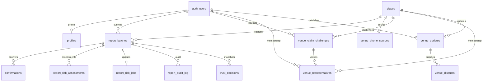
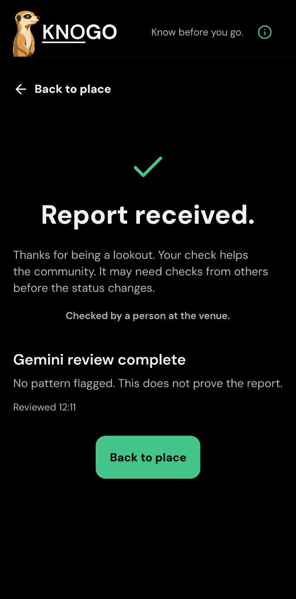

# Milestone Evidence And Work Board

Updated: 11 October 2026. Milestone: 14 October. Hand-in: 28 October.
Branch: `codex/dv300-milestone`, uncommitted work based on `7935b36`.
This records implementation and checks, not a completion or deployment claim.

## Evidence Index

| Item | Evidence | Limit |
| --- | --- | --- |
| Project board and roadmap | [Board document](evidence/milestone-board.html) and [inspected capture](evidence/milestone-board.jpg), 11 October | Dated snapshot of priorities, owners and proof limits; not a live tracker or completion claim. |
| Reporting scenarios | [37 case groups with source/test names](DV300_REPORT_SCENARIOS.md), rerun on 11 October | Automated trust/flow evidence, not 37 manual/device/provider walkthroughs. |
| Core/browser tests | `pnpm test`: 25 files, 254 tests on 11 October | Provider requests are mocked in unit tests. |
| Mobile tests | `pnpm test:mobile-flow`: 35 files, 404 tests on 11 October | DOM adapters do not prove Android or TalkBack behaviour. |
| Mobile types | `pnpm typecheck:mobile` passed on 11 October | Not a runtime check. |
| Report/database permissions | `scripts/checkin-database-qa.mjs` passed on 11 October | In-memory PostgreSQL, not hosted configuration. |
| Region migration | `scripts/region-migration-qa.mjs` passed on 11 October | Initial regions and legacy areas paths, including repeat execution. |
| Trip quotas | `scripts/trip-database-qa.mjs` passed on 11 October | Server permissions/caps, not a provider route. |
| Docker account flow | `scripts/milestone-local-qa.mjs` passed on 9 and 11 October | Account confirmation, inbox delivery, login, report persistence, unavailable receipt, logout and refresh revocation through API. |
| Browser account return | UI signup, inbox link, token removal, session reload and sign-out passed on 11 October | Docker accounts only. Report confirmation returns saved source/answer to review without submitting. |
| Docker role boundaries | `scripts/milestone-local-role-qa.sql` passed on 11 October | Visitor reads but cannot report/publish; reporter cannot publish; representative fixture publishes/disputes. Fixture changes roll back. No SMS delivery proof. |
| Browser report | 11 October sign-in, phone-source submission, unavailable-review receipt and persisted status after reload | Docker fixture; 375px review/receipt and 768px status captures. No Gemini provider call. |
| Trip provider/UI | 11 October address search, route/fuel result, return leg, offline failure and retry | Existing hosted trip endpoint and public landmark, not device GPS; sample fuel inputs, not current pump prices. |
| Design evidence | Screenshots accepted instead of Figma, user confirmation on 11 October | Captures and layout review still needed. |
| Outside test | Tester arranged for 11 or 12 October | Observations not received. |
| Gemini | Adapter, worker, queue, receipt and boundary tests | No provider response demonstrated. Terms/access/quota/billing checks remain. |

The core suite was rerun after the absent-target outcome fix: 254 tests passed.
Its adapter, queue and entry checks also passed (26 tests). Root TypeScript
passed. React Router future warnings and existing PlaceDetail act warnings
remain. No app dependency or lockfile was changed in this worktree.

## Scope Since The Pitch

The milestone scope remains the Must / Nice / Future list in the goal document.
No map, SMS provider purchase, shop pricing or deployment is added to this goal.
The proposal was reread through Google Slides on 11 October, revision
`moi6qHdwqT4Wsw`. Object IDs below identify source slides, not page numbers.

| Pitch Item | Milestone Position | Reason / Remaining Difference |
| --- | --- | --- |
| Launch group: restaurants, bars and fast-food in Pretoria East (`p6`, `p11`) | Retained | Keeps the catalogue and reporting work within the launch group; expansion stays Future. |
| Browse/search, evidence/timestamps, reports and publication rules (`p11`) | Retained | Browser and database proof recorded below. Gemini provider proof remains pending. |
| Phone claim, venue update and dispute (`p11`, `p13`) | Role enforcement proved; delivery not demonstrated | No approved R0 SMS/voice provider. A rollback-only fixture proves permissions, not delivered OTP or ownership verification. |
| Contextual Gemini assessment (`p9`) | Required for milestone; not yet demonstrated | Adapter sends pseudonymous observation/actor/venue IDs, time buckets, methods and answers. It does not send account-age bands or explicit conflict fields, or return per-reason evidence IDs. Those pitch differences remain; do not claim parity. |
| Uncertainty, disagreement and qualified community closure (`p8`) | Retained in evidence-derived statuses | Listed-hours outlook was added at the user's request. Expected open/closed is a schedule expectation, not a community report or a persisted live answer. |
| Trip fuel planning | Added after the pitch at the user's request | Supports the cost of deciding to visit. Provider distance, sample fuel maths and failure/retry were demonstrated; this is not navigation or a pump-price promise. |
| Maps/location context in inspiration | Trip map deferred at the user's request | Trip result stays useful without a map. Branch map/library remains in scope to preserve, not remove. |
| Brand tile (`knogo_style_tile`) and dark wireframes (`p15`) | Retained brand tokens; flows evolved through code | Light tokens preserve Green #0B4F2F, Paper #F3F3E8 and Ink #17221B. Dark theme uses role tokens. Sheets, staged reports and account entry follow the user's later feedback. Screenshots accepted instead of Figma on 11 October. |
| Saved places, notifications and report-history filters (`p11`) | Not milestone expansion work | Existing saved places remain. Extra notification/history work does not displace required accounts, reports or Gemini proof. |
| Android/iOS and final packaging (`knogo_evaluation`, `p16`) | Browser milestone proof; Android remains Nice, iOS Future | No Android/TalkBack or installed-size claim. Deployment remains deferred and gated by approval/cost checks. |

The pitch's 30-reporting-scenario target is not proved by the total suite count.
The reporting scenario index now maps 37 automated case groups to rerun tests;
it does not prove 30 manual/device/provider walkthroughs. Android/Week 6
promises require their own review before final hand-in. The milestone's "40%"
expectation does not mean the whole proposed system has been completed.

## Account And Role Proof

On 11 October, a browser-created account received its confirmation in the
Docker inbox. Following that link returned to Settings, signed in and removed
tokens from the URL. Reload retained the session. Sign-out followed by reload
returned to the visitor account entry.

A second browser signup began from a guest report draft. Its callback included
the review intent and test place. Confirmation returned to Review your check
with By Phone and Yes, Open preserved. Submit check remained a user action.
The test venue's report count stayed at two before and after confirmation:
no report was submitted by account creation or callback handling.

The role test uses the same Docker PostgreSQL server as the app. It checks
visitor catalogue read and denied report/update calls, reporter update denial,
and representative access/update/dispute success. The representative is a
transaction-only fixture, not a claim that SMS verification was delivered.
After rollback, representative and venue-update counts for the test venue
were both zero. Existing reports were not deleted or altered.

Run the role check from the milestone worktree in PowerShell:

```powershell
Get-Content -Raw scripts/milestone-local-role-qa.sql | docker exec -i supabase_db_milestone-local psql -U postgres -d postgres
```

It requires a confirmed `milestone-browser-...@example.test` account and the
browser test venue. Do not run this fixture script against a hosted database.

## Browser Captures And Checks

All captures below were inspected on 11 October in the milestone worktree.
They contain no credentials. Account/report data belongs to the Docker test
database. The trip preview reads the catalogue and calls the existing hosted
trip endpoint; it does not write hosted reports or change provider settings.

| Capture | What It Shows |
| --- | --- |
| [Light home, 375px](evidence/home-light-375.jpg) | KNOGO identity, community/trip scope, search entry and existing artwork. |
| [Light browse, 375px](evidence/browse-light-375.jpg) | Search/filter hierarchy, grouped list, source-qualified statuses and disagreement. |
| [Light filters, 375px](evidence/filters-light-375.jpg) | Keyboard-expanded area accordion, search, checkboxes, focus outline and footer actions. |
| [Settings, 375px](evidence/settings-375.png) | Signed-out account entry, preference rows and navigation. |
| [Light settings, 375px](evidence/settings-light-375.png) | Light preference applied through the app; signed-out account entry and navigation fit. |
| [Light status, 375px](evidence/status-light-375.png) | Report/source/time, missing kitchen check, practical accordion and report action. |
| [Expired report, 375px](evidence/status-expired-375.png) | Five-hour-old report is not a live answer; missing hours are stated without inventing a schedule. |
| [Conflicting reports, 375px](evidence/status-conflict-375.png) | Phone-open and in-person-closed answers remain visible with source/time under disagreement. |
| [Report review, 375px](evidence/report-review-375.png) | Phone source, open answer and submit/edit actions; skipped answers are absent. |
| [Report receipt, 375px](evidence/report-receipt-375.png) | Saved report with unavailable assessment; no fabricated Gemini result. |
| [Status sheet, 768px](evidence/status-768.png) | Persisted report answer, source/time and collapsed practical checks. |
| [Trip result, 375px](evidence/trip-estimate-375.png) | Provider distance/time and fuel cost, origin, destination and return control. |
| [Trip offline, 375px](evidence/trip-offline-375.png) | Previous estimate removed; connection error and retry action remain. |
| [Text-size simulation, 375px](evidence/status-text-simulation-375.png) | Browser text and line heights doubled; sheet content wraps and scrolls. Not Android text-size or browser-zoom evidence. |

- Place/status and report-source layouts were checked at 320, 375, 414, 768
  and 1440 CSS pixels. The checked pages had no horizontal overflow. Report
  source controls fit in the viewport at each width, with 44px radio targets.
- Home and restaurant results were also checked at 320, 375, 768 and 1440px
  on 11 October: no page horizontal overflow; home search is 60px high and
  filter entry is 52px high. Captures above show the 375px light state.
- Home, explore, global search and restaurant category titles lacked heading
  semantics in the browser tree. Added native Text header roles without
  changing styling; browser snapshots then exposed each as a level-one heading.
  This is scoped heading evidence, not whole-app structural conformance.
- Filter Tab/Enter expanded Areas with aria-expanded=true. Tab/Space selected
  Brooklyn, exposed checked=true and updated the result to its one branch.
  Clear filters restored ten items. Cuisine expansion exposed its search and
  checkboxes. Escape closed the sheet and returned focus to Open filters.
  At 375px, the expanded area's footer actions were 52px high and inside the
  812px viewport. Both area and cuisine bodies may scroll; footer stays reachable.
- At 320px, Tab entered the status sheet, showed a focus outline, and Escape
  returned focus to its trigger. At 375px with doubled text, Tab reached the
  report action by scrolling the sheet; cycling focus stayed inside it.
- Browser zoom shortcuts did not change the measured scale. Do not treat the
  text-size simulation as a passed 200% browser-zoom check. Android text size,
  TalkBack and remaining screens remain to test. Light settings/status were
  rendered and inspected at 375px; other light-theme states remain untested.
- Measured light status-sheet text pairs: #17221B on #E9EDE7 = 13.84:1,
  #505A52 on #E9EDE7 = 6.06:1, and #F3F3E8 on #0B4F2F = 8.65:1.
  These exceed 4.5:1 for the sampled text; they are not a whole-app contrast audit.
- Theme/control checks passed: 130 contrast-token tests and twelve web-renderer
  tests. These cover named token pairs and control semantics, not every image,
  overlay, screen reader or device. No WCAG conformance claim is made.
- Two regressions failed before their fixes: the reports action's accessible
  name did not contain its visible label; report progress had no browser value.
  Both now match browser inspection. Native View supports the same progress
  props, but native announcements remain untested.
- A third regression exposed unnamed browser dialogs. Four renderer cases
  failed before adding accessible labels to PlaceSheet and FilterSheet;
  the same label prop now names Home search. Browser snapshots verified
  Status & checks, Search KNOGO and Filters. Status Tab focus remained visible;
  Escape closed it and restored focus to View recent reports. Full mobile
  suite then passed with 403 tests; mobile TypeScript passed.

### Expiry And Conflict Proof

`scripts/milestone-local-status-fixtures.sql` creates two invented venues in
the Docker database, using two confirmed browser test accounts. It inserts
three fixture batches/answers, never provider assessments. Assertions require
unknown for the five-hour-old report and disagreement for the two opposing
reports. Repeating the script immediately inserted no duplicate rows and
passed. The conflict reports expire after four hours; the script then fails
its disagreement assertion instead of renewing or concealing their age.

Browser checks on 11 October at 375px showed Check before leaving and No recent
check for the expired venue, not open/closed. The listed-hours sheet stated
both trading and kitchen hours were not published. Contact details not listed
appeared alongside Directions, without Call or Website.

The conflict venue showed Reports differ. Its sheet retained Community / phone:
reports open and Community / in person: reports closed, each with time/expiry.
There was no unqualified closure or erased answer. Both checked sheets had no
horizontal overflow; the expired-sheet report action fit within the viewport.

This found a copy defect: the unlisted-hours outlook was described as based
on listed hours. A regression failed, then the sheet reused the core outlook's
detail rather than a fixed schedule caption. Browser then displayed Hours are
not listed for this time. Contact the venue to check. Full mobile suite passed
with 404 tests; mobile TypeScript passed.

The fixtures are catalogue-visible in the local test backend only, not hosted.
Run them only through `supabase_db_milestone-local`, as with the role script.
They prove presentation of seeded evidence, not provider assessment, real-world
reports, delivery verification or an outside-user test.

### Trip Provider Proof

The origin was the public Gautrain Hatfield Station address, selected through
the app's address search, with Cappuccinos Menlyn as the destination. No device
location permission was requested. Fuel inputs were samples: 7.5 L/100 km and
R23/litre, saved only in the isolated browser's preferences.

The provider returned 10,003.5 metres and 859.8 seconds outbound. KNOGO showed
10.0 km, 15 minutes and R17.26. Calculation uses the unrounded distance:
`10.0035 * 7.5 / 100 * 23 = 17.2560375`. The information view exposed consumption,
price, litres and the absence of live traffic. The return request supplied
9,013.2 metres, not a doubled-distance assumption; the result became R32.80
without changing the outbound arrival. Offline refresh removed the old result;
reconnecting and retrying restored it.

Read-only quota queries showed one address and three route reservations after
the demo, within the existing 100/day and 10/minute caps. The official Standard
plan page was checked on 11 October: EUR0, directions 2,000/day and 40/minute,
geocoding 3,000/day and 100/minute. No upgrade or payment was selected. Sources:
[ORS plans](https://account.heigit.org/info/plans) and
[request restrictions](https://openrouteservice.org/restrictions/).
The user's 2 October no-payment account confirmation remains the account-level
record; this check did not sign in to their ORS billing account.

## Schema Compared With Pitch

Pitch slide 12 was inspected on 9 October. Migration files were inspected on
11 October. The pitch is a proposal; these differences must be explained in
the demo rather than claiming the schema matches it field for field.

| Pitch entity | Implementation | Difference / Reason |
| --- | --- | --- |
| Places | `public.places` | Text catalogue IDs rather than UUIDs; supports existing routes and imported catalogue. |
| Profiles | `public.profiles`, `auth.users` | Profile keyed by the Auth user UUID. Auth owns identity. |
| Report batches and answers | `public.report_batches`, `public.confirmations` | Answer rows reference a batch. Live expiry is derived from report time plus four hours, not a batch expiry column. |
| AI assessments | `knogo_private.report_risk_assessments` | Enum risk, text-array reasons, model, outcome, assessed/expiry times. App reads an author-only receipt, not the private table. |
| Venue claims | `venue_claim_challenges`, `venue_representatives` in `knogo_private` | Delivery/verification challenge plus expiring membership rather than one claim record. Access is checked against sourced phone evidence. |
| Venue updates | `knogo_private.venue_updates` | Place and user keys; membership checked when publishing and reading rather than an update claim foreign key. |
| Disputes | `knogo_private.venue_disputes` | Links to the venue update and check type. No link to a particular community batch; this is a remaining pitch difference. |
| Audit records | `public.report_audit_log`, `knogo_private.trust_decisions` | Batch audit and versioned trust snapshots rather than one entity-wide audit table. |

### Implementation Relationships

This diagram covers the report/venue entities, not every catalogue, provider
or Auth table. Names without a schema below belong to `knogo_private`.



## API Boundaries

Supabase API URLs below are relative to the configured backend. Never capture
request credentials, confirmation links or session tokens as evidence.

| Endpoint / Command | Caller | Purpose |
| --- | --- | --- |
| Auth signup, verification, password token and logout endpoints under `/auth/v1` | Account flow | Account lifecycle; confirmation remains required in the test backend. |
| `POST /rest/v1/rpc/submit_status_report` | Signed-in, non-anonymous reporter | Validate and persist batch/answers; queue review in the transaction. |
| `POST /rest/v1/rpc/read_report_assessment` | Batch author only | Return review state and completion metadata; no other reporters or pattern reasons. |
| `read_place_trust` / `current_live_statuses` | Visitors and accounts | Read evidence-derived claims, disagreement, times and expiry. |
| `read_venue_access` / `publish_venue_update` | Signed-in account | Read own access; publishing requires representative access. |
| `report-risk` function | Server worker secret only | Claim at most three jobs per request, call provider and finish with lease verification. Not a mobile endpoint. |
| `trip-planner` function | Trip client | Address/route request with validation, provider reservation and failure handling. |

## Gemini Request And Failure Rules

Source: `supabase/functions/_shared/providerServices.ts` and report-risk entry.
The request asks for reporting-pattern risk for a target observation. It
forbids deciding venue status, truth, guilt, account blocking or independence.
Input JSON is data, not instructions.

- HMAC pseudonyms replace actor, venue and report IDs. These are not proof of
  anonymity. Use only invented test records for the unpaid demonstration.
- At most 100 observations, enum check methods and enum answers are sent.
- Output permits only `risk` and `reasons`, with allowed enums and lengths.
  Insufficient context becomes unknown risk, not low risk.
- Missing target context is `malformed`, not `assessed`: no provider call and
  no completed-review claim. This regression failed, then passed on 11 October.
- Missing setup, reservation failure, quota, timeout, invalid output and
  provider failure preserve unknown risk. They do not decide public closure.
- Receipt polls every five seconds, stopping after six reads or a terminal
  state. Unmount ignores pending responses. Manual retry reads, not resubmits.
- Model and account eligibility must be checked before the provider demo.
  Tests containing a model name do not prove that model is available.

## Work Board

| Priority | Task | State | Completion Evidence |
| --- | --- | --- | --- |
| 1 | Restore Docker testing runtime | Passed after user updated Docker on 11 October | Engine responds; existing database/inbox started without reset; account/report API checks passed. |
| 1 | Gemini account/terms/quota check and demo | Pending user terms step and account checks | Backend sends test report to provider; response appears in KNOGO. |
| 1 | Outside-user test | Tester arranged | Tasks, observations and resulting fixes recorded. |
| 1 | Account/report reload and role demo | Passed in Docker/browser on 11 October | Signup and report-review callbacks, session/reload/logout, report persistence and role assertions above. Representative fixture does not prove SMS delivery. |
| 2 | Trip distance/fuel demo | Browser provider result and offline retry passed on 11 October | Captures and Trip Proof above; device location remains untested. |
| 2 | Screenshot/layout/accessibility checks | Captures and scoped browser checks recorded; further checks pending | Widths, keyboard, text simulation and light settings/status above; device, other light states and zoom gaps stated. |
| 2 | README, evidence captures and rehearsal | Pending | Setup/limits documented; 13 October rehearsal passes demo sequence. |
| 3 | Merge or deployment | Not authorised | User approval required; no milestone deployment. |

## Risks And Dates

### Android Gemini Proof: 14 October 2026

The fixture report travelled from the Android development build through the
hosted report queue and report-risk worker to Gemini 3.5 Flash-Lite. The
database records one provider call, an assessed result and a complete job at
12:11:39 SAST. The user supplied the phone receipt below, showing review
completion and the limitation that this does not prove the report.



The first worker invocation returned 503 before any provider reservation. A
bounded database retry was deployed, and the next human invocation completed
the review. The test gate is disabled. No scheduler or use of other users'
reports is enabled. This proves the fixture integration and phone receipt,
not production automation, Google sign-in, TalkBack or WCAG conformance.

### Pitch Risk Comparison

The technical-risk line in `p13` named invalid AI output, OTP failure, stale
evidence and conflicts. The implementation and remaining evidence are:

| Pitch Risk | What Occurred / What Was Checked | Resolution / Next Action |
| --- | --- | --- |
| Invalid AI output leaves status unknown | Adapter validation/failure tests pass; missing target incorrectly claimed an assessment | Missing-target regression fixed. Real provider malformed-output/failure and UI demo remain pending; no mock response counts as Gemini proof. |
| OTP failure leaves claim unverified | No approved zero-cost delivery provider is configured | Server denies reporter updates. Representative permissions use a rolled-back fixture. No delivered SMS or completed phone claim is asserted. |
| Stale evidence becomes unknown | Four-hour expiry/freshness tests and five-hour fixture browser demo passed | No live answer from the expired report. Listed-hours expectations remain separate. Rehearsal still required. |
| Conflict becomes disagreement | Trust/database tests plus phone-open/in-person-closed browser fixture demo passed | Both source/answer/time lines remain; representatives cannot erase community evidence. Rehearsal still required. |

These are comparisons against the pitch, not claims that risks have disappeared.
The user still needs the verbal update during rehearsal.

| Risk / Finding | Resolution Or Next Action |
| --- | --- |
| Regions migration read an absent areas table | Guarded legacy work; both database paths and repeat execution pass. |
| Missing target could be labelled assessed without Gemini | Outcome changed to malformed; regression observed failing then passing. |
| Hosted trust worker/schema absent at 9 October audit | Keep demonstration on test data; do not claim live deployment. |
| Docker inference socket prevented startup | User updated Docker. Containers and account/report API checks passed on 11 October without deleting volumes or resetting the database. |
| Gemini terms/free quota and eligibility not established | User handles terms; agent checks account limits before requests. No billing activation. |
| Venue verification delivery has no approved zero-cost provider | Role restrictions can be demonstrated using test fixtures. Do not pretend an SMS/voice message was delivered. |
| Phone, TalkBack and text scaling not demonstrated | Record gaps; browser/DOM tests do not establish WCAG conformance. |
| Changes in the original checkout since worktree creation | Leave them untouched. Review branch-map changes with the user before any future merge. |

- 11-12 October: restore test runtime; verify provider setup; complete outside test.
- 13 October: address test findings, gather captures and rehearse.
- 14 October: demonstrate only verified flows, with remaining gaps stated.
- 15-21 October: account/device testing, trust/AI privacy review and fixes from feedback.
- 22-27 October: regression/accessibility testing, evidence and hand-in rehearsal;
  assess deployment prerequisites and costs, seeking approval before deployment.
- 28 October: hand-in. Do not promise a deployed build before those gates pass.
